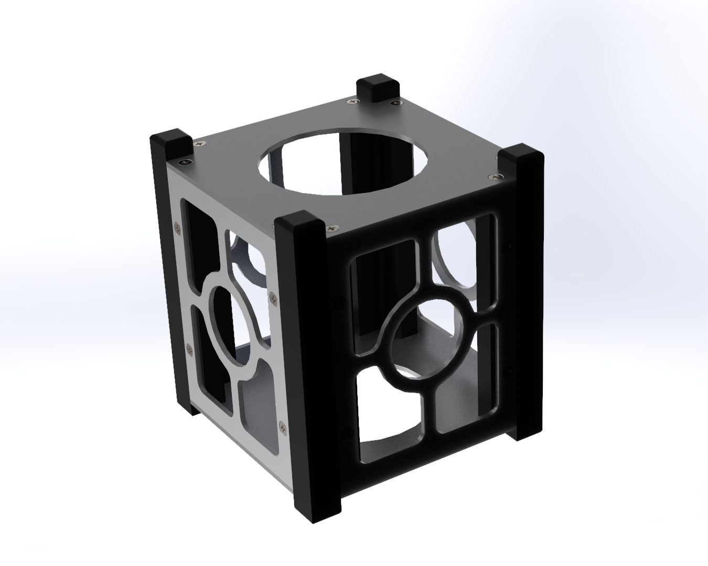

# 📁 Progetto Meccanico CubeSat 1U

Repository ufficiale contenente l'intero sviluppo ingegneristico, la modellazione CAD 3D, le messe in tavola tecniche per la produzione, le analisi strutturali e termiche (FEA) di una struttura **CubeSat 1U** progettata in conformità agli standard internazionali **CubeSat Design Specification (CDS)** per il rilascio tramite dispenser P-POD.

---

## 🛠️ Specifiche Tecniche e Standard di Progetto
* **Formato Standard:** CubeSat 1U.
* **Materiale Strutturale:** Alluminio 6061-T6 (eccellente rapporto resistenza/peso e ottima stabilità termica).
* **Viteria di Assemblaggio:** Interfacce filettate standardizzate M2.5.

---

## 📂 Struttura della Repository

```text
├── CAD/                  # Modelli nativi SolidWorks
├── Renders/              # Render fotorealistici
├── Reports/              # Report completi di validazione FEM strutturale e termica
├── Tavole/               # Messe in tavola in PDF
└── README.md             # Documentazione tecnica del progetto
```

---

## ⚙️ Fasi di Sviluppo e Ingegnerizzazione

### 1. Modellazione CAD e Gestione dei Componenti
* **Struttura Portante (Guide/Rotaie):** Progettate per rispettare rigorosamente i limiti geometrici imposti dal CDS in termini di tolleranze di contatto con le guide del dispenser P-POD ed evitare fenomeni di bloccaggio.
* **Piastre Faccia (Superiore, Inferiore e Laterali):** Sviluppate con alleggerimenti geometrici per ottimizzare il bilancio di massa senza compromettere la rigidità torsionale complessiva.
* **Configurazioni e Viste Esplose:** Gestione avanzata tramite ConfigurationManager in SolidWorks per la generazione di viste esplose multi-sequenza, utilizzate per la stesura della distinta base e della bollatura automatica nelle messe in tavola.

### 2. Documentazione Tecnica 2D (Manufacturing)
* Generazione di tavole 2D conformi agli standard industriali, complete di riquadro delle revisioni, tabella dei materiali (BOM), indicazioni sui trattamenti superficiali e richiami geometrici basati sulle norme ISO 2768-m.

---

## 🔬 Validazione FEM & Analisi Strutturale (FEA)

Il progetto è stato sottoposto a rigorose simulazioni agli elementi finiti (FEA) per certificarne la resistenza meccanica e l'affidabilità in ambiente operativo:

1. **Analisi di Carico Statico (Condizione di Lancio - 10g):**
   * **Vincoli e Applicazione:** Applicazione di un'accelerazione di picco pari a 10g lungo l'asse principale del satellite, simulando le sollecitazioni estreme imposte dal vettore di lancio.
   * **Risultati:** Le tensioni di von Mises massime registrate sull'Alluminio 6061-T6 risultano ampiamente inferiori al limite di snervamento del materiale, garantendo un ampio margine di sicurezza strutturale (*Safety Factor* elevato).
   * **Gestione delle Singolarità:** Ottimizzazione dei raccordi geometrici interni per eliminare le concentrazioni di sforzo critiche individuate nelle prime iterazioni numeriche.

2. **Verifica Termo-Strutturale:**
   * Analisi del comportamento termico sui piani di contatto tra le piastre e la struttura portante, verificando la corretta dissipazione del flusso termico ed escludendo deformazioni termiche tali da compromettere lo scorrimento all'interno del dispenser.

3. **Analisi Modale (Frequenze Naturali):**
   * Estrazione delle prime frequenze proprie della struttura per evitare fenomeni di risonanza con lo spettro di risposta in frequenza (SRS) del vettore di lancio.
   * La prima frequenza di risonanza è risultata ampiamente superiore al requisito minimo imposto dai 100 Hz di soglia tipica dei lanciatori commerciali.

---

## 🖼️ Rendering
*(Visualizzazione fotorealistica generata tramite SOLIDWORKS Visualize con finiture in alluminio naturale/anodizzato e sfondo tecnico neutro antracite)*

<p align="center">
  
</p>

---
*Progetto sviluppato come parte di un portfolio di ingegneria aerospaziale.*
